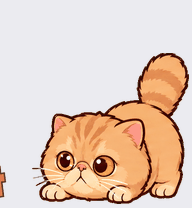

# BeCa: acompañante animado para Claude Code

 

App local de macOS que muestra a BeCa, un gato Exotic Shorthair en estilo sticker, en una ventana flotante. Cambia de pose según los hooks de ciclo de vida de Claude Code: teclea cuando Claude trabaja, te pide atención cuando Claude necesita una decisión y festeja cuando termina. No modifica la interfaz de Claude Code, no usa la red y no guarda el contenido de tus sesiones.

BeCa es el gato real del autor. Su arte se generó con IA a partir de fotos suyas, que no se incluyen en el repo.

> Proyecto personal, sin afiliación con Anthropic. Clawd, que aparece en una animación, es un personaje de Anthropic: ver [Créditos y licencia](#créditos-y-licencia).

## Contenido y estatus

| Sección | Estatus |
|---|---|
| [Requisitos](#requisitos) | VERDE |
| [Instalación](#instalación) | VERDE |
| [Uso diario](#uso-diario) | VERDE |
| [Conectar proyectos](#conectar-proyectos) | VERDE |
| [Estados y eventos](#estados-y-eventos) | VERDE |
| [Sonido](#sonido) | VERDE |
| [Privacidad](#privacidad) | VERDE |
| [Limitaciones](#limitaciones) | AMARILLO: dependen de lo que Claude Code expone |
| [Animaciones](#animaciones) | VERDE |
| [Rendimiento](#rendimiento) | VERDE |
| [Cambiar la mascota](#cambiar-la-mascota) | VERDE |
| [Desinstalar](#desinstalar) | VERDE |
| [Estructura del repo](#estructura-del-repo) | VERDE |
| [Créditos y licencia](#créditos-y-licencia) | AMARILLO: el uso de Clawd no está validado con Anthropic |

## Requisitos

- macOS. Probado en macOS 27.2 con Apple Silicon; otras versiones no se han probado.
- Herramientas de línea de comandos de Xcode, que traen `swiftc`, `clang` y `/usr/bin/python3`:

```bash
xcode-select --install
```

- Claude Code con hooks. Probado con las versiones 2.1.304 y 2.1.317.

## Instalación

```bash
git clone https://github.com/BEG-lag/beca-claude-code.git
```

```bash
cd beca-claude-code && make install
```

```bash
~/.axo/beca abrir
```

`make install` compila la app y el hook, e instala `~/Applications/BeCa.app` y la carpeta `~/.axo/` con el hook y el comando `beca`. Compila en `~/Library/Caches/AxoBuild` porque las carpetas sincronizadas, como iCloud, agregan atributos que rompen la firma. La app se firma localmente, sin cuenta de desarrollador.

Después conecta los hooks, en todos tus proyectos o solo en algunos: ver [Conectar proyectos](#conectar-proyectos). Sin hooks, BeCa se queda en reposo.

La carpeta `~/.axo` y el identificador interno conservan el nombre del primer diseño, un ajolote llamado Axo.

## Uso diario

```bash
~/.axo/beca abrir
```

```bash
~/.axo/beca cerrar
```

```bash
~/.axo/beca estado
```

`~/.axo/beca ayuda` muestra todos los comandos.

- **Mover:** arrástralo. La posición se recuerda.
- **Clic:** alterna: un clic saluda y el siguiente juega con Clawd unos 4 s, y luego sigue con lo suyo. Al abrir la app empieza con el saludo. En reposo lo despierta: al terminar respira unos 30 s y vuelve a quedarse quieto. Es solo visual: no cambia el estado de Claude, no aprueba permisos ni le responde. Un evento real de Claude tiene prioridad sobre el saludo y el juego.
- **Ocultar o mostrar, cambiar tamaño, salir:** clic derecho sobre BeCa, el ícono de la barra de menús, o `~/.axo/beca ocultar` y `~/.axo/beca mostrar`.
- **Volver a mostrarlo:** `~/.axo/beca abrir` también funciona si está oculto. Abrir la app siempre lo muestra.

**Desactivar la integración sin desinstalar:** los hooks siguen configurados, pero no hacen nada. También se puede desde el menú.

```bash
~/.axo/beca off
```

```bash
~/.axo/beca on
```

## Conectar proyectos

**En todos los proyectos:** agrega solo la llave `hooks` a `~/.claude/settings.json` y conserva lo demás. Antes guarda una copia en `~/.claude/settings.json.antes-de-axo`.

```bash
~/.axo/beca conectar --global
```

```bash
~/.axo/beca desconectar --global
```

**Solo en una carpeta:** escribe los hooks en `.claude/settings.local.json` de esa carpeta. Claude Code lee la configuración de proyecto solo del directorio de trabajo de la sesión, no de carpetas padre: conectar una carpeta **no** alcanza a sus subcarpetas.

```bash
~/.axo/beca conectar /ruta/a/la/carpeta
```

```bash
~/.axo/beca desconectar /ruta/a/la/carpeta
```

En un repositorio git, agrega `.claude/settings.local.json` a `.gitignore`: Claude Code lo excluye solo cuando él mismo crea el archivo.

Los hooks se definen en [hooks/hooks.json](hooks/hooks.json).

## Estados y eventos

| Estado | Evento de Claude Code | Animación |
|---|---|---|
| `ready` Esperando | `SessionStart` (`startup`, `resume`, `clear`) | Saluda 2 veces y queda en reposo |
| `working` Trabajando | `UserPromptSubmit`, `PreToolUse`, `PostToolUse` sin edición, `PostToolUseFailure` | Teclea en el aire |
| `reviewing` Revisando | `PostToolUse` de `Edit`, `Write`, `MultiEdit`, `NotebookEdit` | Inspecciona con la pata en el mentón |
| `completed` Terminó | `Stop` | Salta 4 veces, saluda 2 y reposa: unos 5 s |
| `attention` Necesita atención | `PermissionRequest`, `Notification`, `PreToolUse` de `AskUserQuestion` o `ExitPlanMode` | Pide con las patas juntas |
| `failed` Error | `StopFailure` | Se desinfla, una vez |
| `ended` Reposo | `SessionEnd` | Reposo |

`failed` y `ended` se agregaron porque, sin ellos, BeCa se quedaría en "trabajando" tras un error de API o al cerrar la sesión.

Los tiempos de la app se eligieron a criterio [SUPUESTO]: "revisando" dura al menos 1.5 s; el fin de sesión espera 5 s al festejo y 2.6 s al error; "trabajando" y "revisando" expiran a los 10 minutos sin eventos; el reposo respira unos 30 s y luego se queda quieto; "atención" se queda fija tras unos 5 minutos. Los dos últimos se ajustan con `restCycles` y `attentionCycles` en `app/main.swift`.

### Qué se verificó

| Prueba | Resultado |
|---|---|
| Sesión interactiva real, Claude Code 2.1.304 | `SessionStart`, `UserPromptSubmit`, `PreToolUse`, `PermissionRequest`, `Stop`, `SessionEnd`, `AskUserQuestion` y notificaciones |
| Sesión `-p` real, 2.1.304 y 2.1.317 | `PostToolUse` con `Write`, `Stop`, `SessionEnd` |
| Fallo real de API (modelo inexistente), 2.1.304 | `StopFailure` |
| Sesión viva de la app de escritorio, 2.1.317 | Toma los hooks globales sin reiniciar; `PreToolUse` observado |
| Carpeta sin configuración propia, con hooks globales | `SessionStart`, `UserPromptSubmit`, `Stop`, `SessionEnd` |
| Píxeles dibujados contra el sprite sheet | 7 de 7 clips exactos ([imagen](docs/estados-verificados.png)) |
| Privacidad, desactivar, expirar, cerrar, ocultar y reabrir | Correctos |
| Clics y arrastres reales del sistema | Saludo en reposo y trabajando, arrastre sin saludo, sin quitar el foco |
| Clic alternado | En 10 clics seguidos se alternaron saludo y juego. Saluda 1.6 s o juega 3.8 s y regresa a reposo; un evento de Claude a media jugada la interrumpe |

Las notificaciones se identificaron por su momento (6 s tras el permiso y 60 s tras terminar), porque BeCa no registra qué evento las produjo.

**No se ejercitaron:** `ExitPlanMode`, `PostToolUseFailure`, `Edit`, `MultiEdit`, `NotebookEdit` y los tipos `elicitation_*` y `agent_needs_input`. En la interfaz de la app de escritorio solo se observó `PreToolUse`; los demás eventos de la 2.1.317 se probaron con su binario en modo `-p`.

## Sonido

| Momento | Sonido | Archivo |
|---|---|---|
| Claude pide una decisión | Un toque de cascabel, grave, 0.8 s | `attention.m4a` |
| Claude termina | Ronroneo corto, 0.9 s | `completed.m4a` |
| Error de la API | Cascabel de collar, 1.0 s | `failed.m4a` |
| Clic sobre BeCa | Ronroneo, 1.8 s | `click.m4a` |
| Trabajando, revisando, esperando, reposo | Nada | |

Se activa y silencia desde el menú o con:

```bash
~/.axo/beca sonido off
```

```bash
~/.axo/beca sonido on
```

- **Volumen:** 40% del volumen del sistema, fijado en `soundVolume` de `app/main.swift` [SUPUESTO].
- **Separación mínima:** 2 s entre sonidos, para que varios permisos seguidos no sean un coro [SUPUESTO].
- **Aviso de inactividad:** queda en silencio. Los hooks mandan la misma palabra que en una decisión real, así que la app los distingue por el estado anterior: una decisión llega a media tarea y el aviso, con Claude ya terminado. Con varias sesiones a la vez esa distinción puede fallar.
- **Oculta:** sigue sonando; para evitarlo, usa `beca sonido off`.
- **Cambiar un sonido:** reemplaza el archivo en `app/sounds/` y corre `make install`.

**Origen:** son sonidos generados con IA, no la voz real de BeCa. Higgsfield reserva su modelo de efectos de sonido para su generador de juegos, así que se extrajeron del audio nativo de clips de video de Gemini Omni Flash 1.1 y se recortaron con ffmpeg. Se descartó Wan 3.0 por su ruido de fondo. Primero eran maullidos, que se cambiaron por cascabel y ronroneo porque resultaban insistentes: el cascabel de decisión quedó unos 19 dB abajo del maullido y el ronroneo de terminó unos 17 dB abajo, con ponderación A ([medir_volumen.py](arte-gato/audio/medir_volumen.py)). Los maullidos siguen en `arte-gato/audio/maullidos/`.

## Privacidad

- El hook recibe por argumento una palabra fija y **descarta** el JSON de Claude Code: lo lee solo para vaciar la tubería, sin interpretarlo ni guardarlo ([hooks/axo-state.c](hooks/axo-state.c)).
- `~/.axo/state` contiene solo esa palabra. No hay identificador de sesión, ruta, prompt, respuesta ni comando.
- La app no tiene símbolos de red ni sockets abiertos.
- Prueba: un payload con un texto secreto falso no dejó ninguna coincidencia en `~/.axo`. Un estado desconocido se ignora.
- El hook no imprime nada, porque en `SessionStart` y `UserPromptSubmit` la salida se agregaría al contexto de Claude.

`~/.axo/settings-tocados` guarda las rutas de los archivos de configuración conectados, para poder limpiarlos al desinstalar.

## Limitaciones

Claude Code no expone estas señales, así que BeCa no las finge:

| Situación | Qué hace BeCa |
|---|---|
| Interrumpes a Claude con Esc | `Stop` no se dispara. Sigue en "trabajando" hasta el siguiente evento, o 10 minutos |
| Un comando tarda más de 10 minutos | Pasa a reposo aunque Claude siga trabajando |
| "Revisando antes de terminar" | No hay evento previo al final. "Revisando" significa que acaba de terminar una edición, no que Claude esté revisando |
| Archivos cambiados por `Bash` | No activan "revisando": `PostToolUse` de edición no los ve |
| Apruebas un permiso y el comando tarda | Sigue en "atención" hasta que el comando termina: no hay evento de aprobación |
| Cancelas una pregunta con Esc | Sigue en "atención" hasta tu siguiente mensaje |
| Varias sesiones a la vez | Gana el último evento. Separarlas exigiría transmitir un identificador de sesión |
| Claude queda inactivo 60 s | Pasa a "atención" por `idle_prompt`. Para evitarlo, quita `idle_prompt` del matcher de `Notification` en `hooks/hooks.json` y vuelve a conectar |
| Sesiones en la nube o con `--bare` | No ejecutan estos hooks locales |
| Claude en el navegador o en la app de chat | No tiene hooks: BeCa solo funciona con Claude Code |

## Animaciones

| Animación | Cuándo |
|---|---|
| Reposo | Sin actividad o al cerrar la sesión |
| Saludo | Al abrir sesión, después del festejo, o con clic |
| Trabajando | Claude procesa tu mensaje o usa herramientas |
| Revisando | Claude acaba de editar un archivo |
| Atención | Claude necesita un permiso o una decisión |
| Festejo | Claude termina |
| Error | Falla la API |
| Juego con Clawd | Con clic, alternado con el saludo |

Todo el arte se generó con Higgsfield (GPT Image 2.5) y se procesó con los scripts del skill `hatch-pet`, que no viene en este repo. El de BeCa se hizo a partir de recortes de fotos del gato real, sin fondo ni metadatos; las fotos no se publican. Su sheet ([arte-gato/final/spritesheet.png](arte-gato/final/spritesheet.png)) pasa `validate_atlas.py` como v1; las filas de caminar son relleno de `idle` solo para cumplir ese formato y la app no las usa.

**Faltantes, cubiertas con la pose más parecida:** `completed` usa `jumping` y `waving`; `ready` usa `waving` e `idle`. No se generaron caminar ni las 16 direcciones de mirada, porque esta app no las usa.

`run/tools/normalize_rows.py` reemplaza el ajuste por fila del extractor: usa la misma escala en todas las filas para que BeCa no se encoja al saltar. `run/tools/export_clips.py` recorta del sheet una tira por clip en `app/clips/`, que es lo que carga la app. Los scripts que usan `hatch-pet` lo buscan en `~/.claude/skills/hatch-pet/scripts`, o en la ruta de la variable `HATCH_PET_SCRIPTS`.

**Juego con Clawd (`play`, 35 cuadros, 3.8 s):** Clawd entra caminando, BeCa lo acecha y le da un manotazo, Clawd rebota y regresa rodando, BeCa se le echa encima, lo avienta hacia arriba, cae de espaldas, le hace malabares con las patas y lo patea; al final le dice adiós con la pata y Clawd se va. Las ocho poses de BeCa son generadas ([arte-gato/juego/](arte-gato/juego/)). Clawd no se genera: `run/tools/clawd.py` lo dibuja desde su cuadrícula de píxeles, con un contorno café para que resalte sobre el pelaje, y `run/tools/make_play_clip.py` lo compone cuadro por cuadro. Para ajustar el movimiento, edita `TIMELINE` en ese script, córrelo y copia las duraciones que imprime a `Clips.play` de `app/main.swift`. BeCa se ve un poco más chica en estas poses, porque a escala completa Clawd no cabría en la ventana.

## Rendimiento

Una corrida de 60 s por escenario, con una instancia aislada de los hooks reales, en macOS 27.2 con Apple Silicon. La memoria es la huella física, la misma cifra del Monitor de Actividad. "Antes" es la primera versión y "final" la optimizada.

| Escenario | Memoria antes | Memoria final | CPU antes | CPU final | Despertares/s antes | Final |
|---|---:|---:|---:|---:|---:|---:|
| Quieta, primer minuto | 25.4 MB | 15.5 MB | 0.037% | 0.012% | 2.08 | 0.58 |
| Reposo, más de 30 s sin eventos | no existía | 15.5 MB | no existía | 0.000% | no existía | 0.00 |
| Animando | 25.4 MB | 15.7 MB | 0.100% | 0.135% | 7.63 | 7.50 |
| Ráfaga de 40 cambios/s | 25.5 MB | 18.6 MB | 2.76% | 3.20% | 0.18 | 0.10 |
| Oculta | 25.3 MB | 15.8 MB | 0.021% | 0.006% | 0.43 | 0.18 |

| Otros | Antes | Final |
|---|---:|---:|
| Pico de memoria al arrancar | 36.1 MB | 15.8 MB |
| Tamaño de la app | 2.1 MB | 1.6 MB |
| Tiempo por hook | 8.8 ms | 4.4 ms |
| Procesos por hook | 3 | 1 |
| Procesos al cerrar | 0 | 0 |

- **Sin fugas:** la memoria se mantuvo plana en todos los escenarios, en ambas versiones.
- **CPU animando:** no mejoró. La misma animación dio de 0.08% a 0.14% entre corridas, así que la diferencia cabe en esa variación.
- **WindowServer:** alternando cerrada y animando dio +3.2 ± 6.8 puntos antes y +4.6 ± 8.1 después. El efecto no se distingue del ruido del sistema, ni se puede afirmar que cambiara.
- **Pausa por oclusión:** probada con una ventana opaca encima. Con la pantalla bloqueada o apagada no se probó.

Con el arte del gato (`bench/resultados/gato`) el consumo es equivalente: 15.5 MB quieta, 17.4 MB y 0.136% de CPU animando, pico de 15.9 MB.

El juego con Clawd sube la memoria mientras se reproduce: de 15.9 MB a un pico de 25.1 MB, porque su tira decodificada ocupa más que los demás clips. Regresa a unos 18 MB cuando BeCa vuelve al reposo; esa cifra incluye el motor de audio. La CPU llegó a 4% como máximo y volvió a 0.04%. Sin clic, la tira no se carga.

Después del primer sonido la memoria queda unos 2.5 MB arriba, en unos 18 MB, porque el sistema mantiene cargado su motor de audio. El reposo tras sonar sigue en 0.002% de CPU.

El modo de diagnóstico `AXO_SNAPSHOT_DIR` no refleja el consumo normal: con él se midieron 30 MB.

Los datos están en `bench/resultados/`. Para repetir:

```bash
bench/medir.sh nombre
```

```bash
python3 bench/resumen.py antes nombre
```

## Cambiar la mascota

La app solo necesita ocho tiras en `app/clips/` con estos cuadros de 192x208: `idle` 6, `waving` 4, `jumping` 5, `failed` 8, `waiting` 6, `running` 6, `review` 6 y `play` 35.

Para volver al ajolote original, cuyo arte está en `arte-axo/clips/` (no tiene `play`, así que el juego seguiría mostrando a BeCa):

```bash
cp arte-axo/clips/*.png app/clips/ && make install && ~/.axo/beca abrir
```

## Desinstalar

Quita los hooks registrados, la app y `~/.axo`. Conserva la carpeta del repo.

```bash
~/.axo/beca quitar
```

Los archivos `*.antes-de-axo` quedan junto a cada configuración tocada. Se pueden borrar.

## Estructura del repo

| Carpeta | Contenido |
|---|---|
| `app/` | App en Swift (`main.swift`), `Info.plist`, tiras de animación y sonidos |
| `hooks/` | Hook en C (`axo-state.c`) y plantilla de hooks (`hooks.json`) |
| `bin/axo` | Comando `beca` |
| `bench/` | Scripts de medición y resultados |
| `arte-gato/` | Arte de BeCa: bases, sprite sheet, juego con Clawd y audio |
| `arte-axo/` | Clips del primer diseño, el ajolote Axo |
| `run/tools/` | Scripts para normalizar, exportar y componer clips, y para dibujar a Clawd |
| `docs/` | Imágenes de este README |

No se publican las fotos del gato, las generaciones crudas, el audio sin recortar ni los archivos intermedios de QA.

## Créditos y licencia

- **Código** (Swift, C, shell, Python y Makefile): licencia MIT, ver [LICENSE](LICENSE).
- **Arte y sonidos** de BeCa y de Axo: todos los derechos reservados, ver [LICENSE-ARTE.md](LICENSE-ARTE.md).
- **Clawd** es un personaje de Anthropic. Aparece en la animación `play` como homenaje no oficial. Este proyecto no está afiliado ni respaldado por Anthropic, y ese uso no se ha validado con su titular. Si eres titular de algún derecho y quieres que se retire, abre un issue.
- Hecho con [Claude Code](https://claude.com/claude-code). Arte y sonidos generados con Higgsfield.
